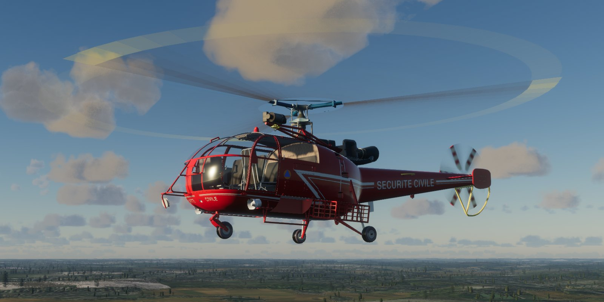

# Sud Aviation SA 316B Alouette III for FlightGear, with a JSBSim model of its articulated rotor



The Alouette III from FlightGear's aircraft collection, with a new JSBSim
flight model in place of the one it flew on, which used JSBSim's generic
rotor. The Alouette III is a light helicopter of 1959 with a fully articulated
three-bladed rotor turning clockwise seen from above, a three-bladed tail
rotor on the right of an open boom, and a single-shaft Turbomeca Artouste
turboshaft that drives the rotor through a centrifugal clutch. The model is
built around those, from public data: the type certificates, published
performance, a few technical papers, a wind tunnel test of its fuselage, tyre
data, and descriptions of the start of its sister, the Lama: a maintenance
column on its engine, and a flight simulator add-on's manual written after
its flight manual.

No flight-test time histories of the Alouette III are public, so the model
can't be checked the way the [Bo 105](https://github.com/MrChillStorm/Bo105)
and [UH-60](https://github.com/MrChillStorm/UH-60) models were. Its test programme
checks what can be checked: the published performance, the flight manual's
start, the rotor's physics against theory, and a whole flight flown by a test
autopilot from lift-off to touchdown. How it was built, and the comparisons,
are in the report:
[Alouette-3-JSBSim-model-report.pdf](Alouette-3-JSBSim-model-report.pdf).

## What's simulated

- **Main rotor.** The three blades are simulated one by one: rigid blades on
  coincident flap and lag hinges 0.119 m from the shaft, with the flap, droop
  and lag stops and a viscous lag damper. Eight aerodynamic segments per
  blade, at their own angle of attack and Mach number, fly tables of the
  blade's NACA 63A011.5 section (Hindustan Aeronautics' "NACA 63A of 11.5 %"),
  built from the C-81 equations for the NACA 0012 with the differences NACA's
  and NASA's wind tunnel tests of the 63A010, 63₁-012 and 0012 show: less
  maximum lift, more drag at moderate lift, and a later drag rise at high Mach
  numbers. The blade is twisted 6°30′, as Hindustan Aeronautics' description
  of the type gives it. The hub's loads come from the blades' loads at the
  hinges, and the rotor speed and the three blades' lag are solved together.
- **Turning the Alouette's way.** The rotor turns clockwise seen from above
  and the tail rotor sits on the right, pushing left: the mirror image of the
  UH-60's and Bo 105's, whose rotor equations this model shares, worked out in
  the aircraft's mirror image. It hovers right side down, as the real one does.
- **Inflow.** A dynamic wake (Peters–He) with ground effect, and the vortex
  ring state of the [MV-22B](https://github.com/MrChillStorm/MV-22) model
  (Johnson's model): in a steep, slow descent
  the rotor loses thrust at a fixed collective, and the descent runs away until
  you lower the nose or the collective. A ring-vortex wake carries the
  rotor's downwash to the tail rotor, stabiliser, end plates, fuselage and
  boom.
- **Tail rotor** built like the main rotor: three blades on their own flapping
  hinges, six segments each on NACA 0018 (root) to 0015 (tip) tables built the
  same way, with its hub's toe and a dynamic inflow. It turns at 1938 rpm,
  5.487 times the main rotor, the ratio of the two rotors' blade-passing
  frequencies in recordings; the published 2001 rpm goes with a main rotor at
  about 365 rpm.
- **Fuselage** from a wind tunnel test of the Alouette III's (20th ERF), the
  open tail boom, the gear and the rotor head added by estimates.
- **Engine.** The Artouste III B is a single-shaft engine: its compressor and
  turbine turn at a constant 33 500 rpm, 94.85 times the rotor's speed,
  whatever the power, held there by an isochronous governor limited by the
  turbine temperature. It starts as published: the starter drops out at 14 000
  rpm, it idles at 16 330 rpm, and a centrifugal clutch takes up the rotor as
  you advance the fuel flow lever; a freewheel lets the rotor overrun the
  engine in autorotation. Once engaged, the spool's inertia adds to the
  rotor's, as much again, so the rotor speed hardly droops when you pull.
- **Flight controls** with hydraulic servos and no stability augmentation, as
  the real aircraft. The original aircraft's autopilot (heading and altitude
  holds) and Amelia, the co-pilot who hovers for the hoist, still work.
- **Landing gear** with the 355×150-4 tyres' spring rates; the nose wheel
  castors.

All of it is JSBSim XML, generated by a script from the transcribed data; no
Nasal runs the flight model.

## Install

Get the files:

```bash
git clone https://github.com/MrChillStorm/Alouette.git
```

Then add the cloned `Alouette` folder in the FlightGear launcher under Add-ons
→ Additional aircraft folders (or start FlightGear with `--fg-aircraft=`
pointing at it), and pick **Sud Aviation SA 316B Alouette III (JSBSim)**.

- Needs FlightGear 2024.2 or later; the lights are built for the HDR renderer.
- The model runs at 480 Hz, for the blades' flap and lag and the tail rotor:
  the lowest rate its results hold at (400 Hz still does; at 360 the clutch's
  run-up changes and at 320 the stopped rotor creeps). Its slow parts run at
  240 Hz (the airframe, the engine) and 120 Hz (electrics, lights, gauges,
  the original autopilot and Amelia, the animations).
- The aircraft is in the `Alouette-3` folder, so it sits next to the
  Alouette-III from the hangar without replacing it.

## Flying it

- **Start.** On the ground the aircraft starts cold and dark (in the air it
  starts running, trimmed, with its cockpit doors shut: it holds still for its
  first seconds while its controls are trimmed). The checklist (Help menu) has the start: rotor brake
  released, battery, alternator and fuel pump on, then the starter. The engine
  lights off and idles at about 16 330 rpm; advance the fuel flow lever and
  the clutch engages from 19 000 rpm of the engine, the rotor turning by about
  21 000 and running up to 353 rpm. The Alouette menu's autostart does it all.
- **Collective** is the throttle axis, inverted: full throttle is the
  collective at the bottom, so pulling the axis back raises it. Untick
  *Invert collective axis* in the Alouette menu's Configuration dialog for
  full throttle at the top (`/controls/al3/invert-collective`). The same menu
  opens FlightGear's Input Devices dialog, which the Mac's menu bar may not
  show.
- **Brakes.** A ground start sets the parking brake (`B` toggles it, as does
  the cockpit lever); while it is on, FlightGear holds both wheels braked
  whatever the brake axes say. An in-air start releases it, so the left and
  right brakes work after the landing.
- **Keys.** `l` landing light; `Ctrl-a` autopilot master, `Ctrl-h` heading
  hold, `Ctrl-b` heading bug, `Ctrl-l` altitude hold; `Ctrl-t` hands the hover
  to Amelia; `Ctrl-w` deploys the winch, `w`/`W` winds it up and down.
- **Trims** are FlightGear's: in a hover the Alouette needs the stick aft and
  a little left, and right pedal.

## How it compares

Every number comes from the scripted test programme in the report. No
flight-test time histories, identified derivatives or blade data of the
Alouette III are public, so the comparisons are with its published
performance and flight manual, and with theory.

| | Reference | This model |
|---|---|---|
| Hover out of ground effect, 2200 kg, sea level | — | 364 kW (324 kW in ground effect, wheels at 1 m) |
| Maximum level speed at the 405 kW continuous rating | 210 km/h maximum speed, V<sub>NE</sub> | 208 km/h |
| Hover ceilings, 2200 kg | out of ground effect 100 m (TD) or 1100 m (Aérostories); in it 1650 or 2850 m | at the ratings far higher (the rotor stalls before the power runs out, at 4877 m); the published ceilings imply 342–378 kW available |
| Rate of climb, 2200 kg | 4.3 m/s (TD), 5.5 m/s (Aérostories) | 7.0 m/s at 405 kW; 4.5–5.9 m/s at 342–378 kW |
| Cruise speed, 2200 kg | 180–195 km/h | 197 km/h at 361 kW |
| Engine start | idle about 15 000 rpm (AOPA Pilot flight test), 16 330 rpm (a cockpit recording), 17 000–18 000 rpm (the Lama's engine); the clutch engages from 19 000 rpm (AOPA), the rotor turning at 19 500–21 000 rpm (a simulator manual after the Lama's flight manual); two recorded starts: light-off at 16 % about 14.5 s after the starter, idle about 30 s later, the rotor locked 45 s after take-up with the spool at 80 % | idle 16330 rpm at 299 °C; light-off 14.1 s after the button; rotor taken up at 20823 rpm, at 95 % 22 s after the lever leaves idle |
| Rotor speed after a power failure at 60 kt, collective held | 270 rpm lower limit in autorotation (TCDS) | 310 rpm in 1.0 s, 270 rpm in 2.4 s |
| Steady autorotation, 2200 kg | about 1700 ft/min (AOPA Pilot flight test, 1972) | least descent 1918 ft/min at 60 kt |
| Vortex ring state, vertical descent | Johnson's model | heave mode unstable from 869 to 2819 ft/min; none from 20 kt |
| Flap and lag frequencies, Lock number | theory, the 3-D model's hinge offset | 1.017 and 0.183 per rev, Lock number 5.1 |

## Known gaps

- **Performance at the rated power.** With the Artouste's 405–420 kW the
  model hovers higher and climbs faster than any published source gives. The
  published hover ceilings, climb rates and cruise speeds agree with one
  another, and with the model, at about four-fifths of that power
  (342–378 kW). Whether less power reaches the real rotor, or the
  real rotor and airframe need a fifth more, the public data don't say: the
  rotor is left untuned and the power at the ratings. The sources also
  disagree with each other (hover ceilings out of ground effect of 100 m
  and 1100 m at the same mass).
- **No dynamic data.** The trims, derivatives and responses rest on physics
  and on estimates (the blades' mass and inertia, scaled from the
  Alouette II's blade; the lag damper; the control ranges; the servos), which
  nothing published checks. It flies like an articulated-rotor helicopter;
  whether like this one, only an Alouette pilot can tell.
- **Blade sections.** The sections' tables are the C-81 0012's with measured
  differences, not tables of the sections themselves: the 63A's maximum lift
  at high Mach numbers is an estimate (no high-speed tests of a 63A section
  were found), and the camber of HAL's "63A of 11.5 %" is not given (the
  model's is symmetrical). The control rigging is not public (the type
  certificate refers to the maintenance manual) and is estimated.
- **Ground effect** has the Bo 105's and UH-60's strength, not fitted; against
  the published ceilings it may be somewhat strong.
- **Not modelled:** blade bending, dynamic stall, failures beyond the engine's.
  The original aircraft's autopilot and Amelia are kept as they were, tuned
  for the old flight model.

## Rebuilding the model and the report

The [`fdm`](fdm) folder holds everything that produced the flight model and the
report. It needs Python 3 with `jsbsim` 1.3, `numpy`, `scipy`, `matplotlib`
and Pillow, and [tectonic](https://tectonic-typesetting.github.io) or another
XeLaTeX for the PDF.

```bash
cd fdm
python3 genal3.py ../Alouette-3 --fg
python3 genal3.py root/aircraft/alouette3
```

- `genal3.py` writes the flight model: `--fg` into the aircraft folder
  (`alouette3.xml` and `Systems/al3-*.xml`, with the bridge to the original
  aircraft's systems), otherwise test versions with the test loadings for the
  scripts below into `root/`. `al3data.py` holds the data with their sources,
  `artouste.py` writes the engine and drive, `data/` holds the transcribed
  tables (the C-81 0012 section, the wind tunnel fuselage, the published
  performance), and `mrwake.py` recomputes the ring-vortex wake tables.
- `harness.py` drives the model offline. `sweep.py` (level-flight trims),
  `performance.py` (hover ceilings), `pathtrims.py` (climbs, autorotations),
  `derivatives.py`, `engine_response.py` (start, governor, power failure) and
  `descent.py` (the vortex ring state) test it; `flights.py` flies it with the
  test autopilot, `genap.py`, the UH-60 model's adapted.
- `report/mkresults.py` runs the whole programme into `report/results/`;
  `report/build.sh` makes every figure, table and number of the report from
  them and builds the PDF.
- `hdrmodel.py` builds the exterior lights for the HDR renderer, `rotorvis.py`
  the rotors' blade-by-blade models and their blur, `startgains.py` the in-air
  start's trim gains.

The papers and documents the report cites are not included.

## Changes to the FlightGear aircraft

Based on the Alouette III for FlightGear by Gerard Robin, with work by David,
Josh, Thorsten Renk and Colin Geniet (3-D model, systems, Nasal). Changed in
2026, all inside `Alouette-3`:

- **Folder.** Renamed from `Alouette-III` to `Alouette-3`, the set file to
  `Alouette-3-set.xml`; the `Aircraft/Alouette-III/` paths inside the files
  point to the new name.
- **Flight model.** The JSBSim model on the generic rotor (kept as
  `Aero/al3-jsbsim.xml`) is replaced by the generated `alouette3.xml` and
  `Systems/al3-*.xml`, run at 480 Hz. `Systems/al3-cockpit.xml` maps the
  original cockpit's switches, levers and gauges, and its systems'
  properties, onto the new model, and holds and trims an in-air start.
- **Collective.** The model's collective is `/controls/al3/collective`, which
  the throttle axis sets when it moves (inverted by default: the set file's
  `/controls/al3/invert-collective`, a checkbox in the Configuration dialog)
  and which is otherwise mirrored back onto the throttle. The cockpit lever
  (`Models/Alouette-III_Cockpit_Command.xml`) and Amelia (`Nasal/crew.nas`)
  use it in place of the throttle.
- **System rates.** The build writes an `execrate` into the channels of the
  original systems it keeps (`steady-behaviour`, `crash-detect`, the
  electrical and lighting systems, `instrumentation`, `autopilot`, `amelia`,
  `animation-dev`, `annunciator`): 120 Hz, crash detection 240 Hz, instead of
  the FDM's full rate.
- **Landing gear animation** (`Systems/animation-dev.xml`): the swing arms'
  and the nose fork's reference is the 3-D model's drawn pose, since the
  flight model's contact points are the drawn tyres' bottoms; the wheels
  rise with the gear's compression and stay on the ground (the old reference
  put them 13 cm into it).
- **Nasal.** `Nasal/airstart.nas` gives an in-air start its trimmed bank;
  `Nasal/hdr.nas` tells the model when the HDR renderer runs;
  `Nasal/effect_manager.nas` no longer stops on a property the HDR renderer
  doesn't set; the old rotor animation loop in `Nasal/init_Run.nas` is gone,
  the blades being driven by the flight model.
- **Rotor models** driven blade by blade by the flight model
  (`Models/Rotors/`, `fdm/rotorvis.py`): each blade at its azimuth, lag, flap
  and pitch, rigid about its hinges (the old model bent it by five times the
  flap angle). As the rotor speeds up each blade fades out and a fan of its own
  blur fades in, the Bo 105's way (`Models/Effects/RotorBlur`); the tail
  rotor's blades fade out and its disc in. The old blend animations, which the
  HDR renderer ignores, are gone.
- **HDR renderer:** the exterior lights are spot lights aimed out through
  their lenses, with the [X-57](https://github.com/MrChillStorm/X-57) model's
  halos (`Models/Lights/HDR/`): the
  alternating position lights, the anticollision beacons, the tail light and
  the searchlight, which swings out with its lamp; the ALS-only lights and heat
  blur are hidden there. The glass, both its outer and its inner (cabin-side)
  layer, has its own physically based effect, as the X-57 pilot's
  sunglasses: a pure reflector, 12 % opaque, with a faint grey-green tint in
  its reflections (about 8 % face on, more toward grazing). It reflects the
  sky and the sun's glint but scatters no light, so no milky film lies over
  the view and no shadows fall on it. It replaces the old chrome and ALS glass
  shaders, which the HDR renderer drew opaque. One- and
  two-channel textures are stored as RGB(A).
- **Test autopilot** (`Systems/al3-autopilot.xml`, set through
  `/autopilot/al3`), as the UH-60's.
- **Set file.** Description, credits, the flight model and its rate, the
  minimum FlightGear version (2024.2.0), the launcher's HDR flag, the fuel
  tank's usable capacity (555 l of its 565 l).

Everything else is as its authors made it; they are credited in the files
themselves.

## Licence

GNU General Public License, version 2, the same as the original aircraft. See
[LICENSE](LICENSE).
