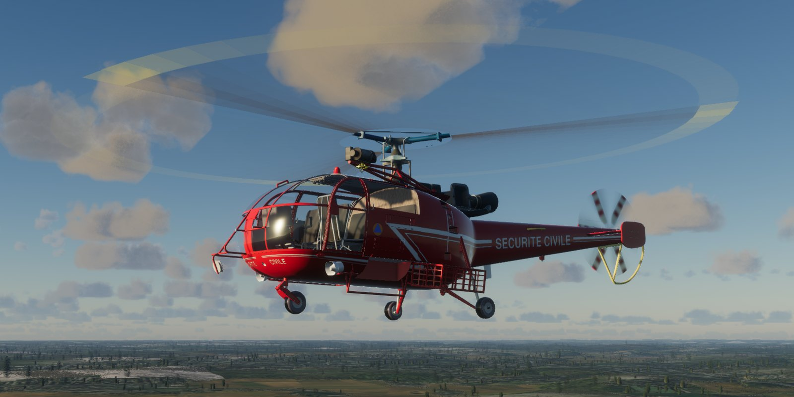

# Sud Aviation SA 316B Alouette III for FlightGear, with a JSBSim model of its articulated rotor



The Alouette III from FlightGear's aircraft collection, with a new JSBSim
flight model in place of the one it flew on, which used JSBSim's generic
rotor. The Alouette III is a light helicopter of 1959 with a fully articulated
three-bladed rotor turning clockwise seen from above, a three-bladed tail
rotor on the right of an open boom, and a single-shaft Turbomeca Artouste
turboshaft that drives the rotor through a centrifugal clutch. The model is
built around those, from public data: the type certificates, published
performance, a few technical papers, a wind tunnel test of its fuselage, tyre
data, and descriptions of the start of its sister, the Lama: a maintenance
column on its engine, and a flight simulator add-on's manual written after
its flight manual.

No flight-test time histories of the Alouette III are public, so the model
can't be checked the way the [Bo 105](https://github.com/MrChillStorm/Bo105)
and [UH-60](https://github.com/MrChillStorm/UH-60) models were. Its test programme
checks what can be checked: the published performance, the flight manual's
start, the rotor's physics against theory, and a whole flight flown by a test
autopilot from lift-off to touchdown. How it was built, and the comparisons,
are in the report:
[Alouette-3-JSBSim-model-report.pdf](Alouette-3-JSBSim-model-report.pdf).

## What's simulated

- **Main rotor.** The three blades are simulated one by one: rigid blades on
  coincident flap and lag hinges 0.119 m from the shaft, with the flap, droop
  and lag stops and a viscous lag damper. Eight aerodynamic segments per
  blade, at their own angle of attack and Mach number, fly tables of the
  blade's NACA 63A011.5 section (Hindustan Aeronautics' "NACA 63A of 11.5 %"),
  built from the C-81 equations for the NACA 0012 with the differences NACA's
  and NASA's wind tunnel tests of the 63A010, 63₁-012 and 0012 show: less
  maximum lift, more drag at moderate lift, and a later drag rise at high Mach
  numbers. The blade is twisted 6°30′, as Hindustan Aeronautics' description
  of the type gives it. The hub's loads come from the blades' loads at the
  hinges, and the rotor speed and the three blades' lag are solved together.
- **Turning the Alouette's way.** The rotor turns clockwise seen from above
  and the tail rotor sits on the right, pushing left: the mirror image of the
  UH-60's and Bo 105's, whose rotor equations this model shares, worked out in
  the aircraft's mirror image. It hovers right side down, as the real one does.
- **Inflow.** A dynamic wake (Peters–He) with ground effect, and the vortex
  ring state of the [MV-22B](https://github.com/MrChillStorm/MV-22) model
  (Johnson's model): in a steep, slow descent
  the rotor loses thrust at a fixed collective, and the descent runs away until
  you lower the nose or the collective. In the hover the blades meet 9 % more
  induced velocity than that wake gives on its own (a little more at higher
  tip Mach numbers), fading out as the wake sweeps back in forward flight.
  Run on a full-size Bo 105 rotor tested in NASA Ames' 40×80 ft tunnel (NASA
  TM-85892 and TM-85990), the model's own hover method needs less power than
  was measured, by about the same factor at every blade loading, and less
  collective. The correction takes its shape from the Bo 105 and its strength
  from the Alouette: one number, fitted to the flight manual's hover at 100 m
  (see *How it compares*). A ring-vortex wake carries the
  rotor's downwash to the tail rotor, stabiliser, end plates, fuselage and
  boom.
- **Tail rotor** built like the main rotor: three blades on their own flapping
  hinges, six segments each on NACA 0018 (root) to 0015 (tip) tables built the
  same way, with its hub's toe and a dynamic inflow. It turns at 2001 rpm
  with the main rotor at 353.2, 5.665 times its speed, as Aerospatiale's type
  specification of 1973 gives it. Recordings of governed rotors show 5.487,
  3 % lower, so the sim's tail rotor tone is about 3 Hz above theirs (100 Hz
  against 97).
- **Fuselage** from a wind tunnel test of the Alouette III's (20th ERF), the
  open tail boom, the gear and the rotor head added by estimates. In a side
  wind each push on it comes from the airflow that hits that surface.
- **Engine.** The Artouste III B is a single-shaft engine: its compressor and
  turbine turn at a constant 33 500 rpm, 94.85 times the rotor's speed,
  whatever the power, held there by an isochronous governor. Its fuel stops at
  the turbine's temperature limit, or at 420 kW, the type specification's
  maximum available power, limited by the reduction gearing, which holds up to
  4500 m in the standard atmosphere. Pull for more and the rotor slows: at
  2200 kg the hover at sea level already takes about 391 kW, and from the hover
  at 1000 ft, 10 % more of the lever's travel slows the rotor to about 330 rpm.
  Keep pulling and it can stall, so lower the lever when the rotor speed drops.
  It starts as published: the starter drops out at 14 000 rpm, it idles at
  16 330 rpm, and a centrifugal clutch takes up the rotor as you advance the
  fuel flow lever; a freewheel lets the rotor overrun the engine in
  autorotation. Once engaged, the spool's inertia adds to the rotor's, as much
  again, so the rotor speed hardly moves when you pull within the engine's
  power.
- **Flight controls** with hydraulic servos and no stability augmentation, as
  the real aircraft. The original aircraft's autopilot (heading and altitude
  holds) and Amelia, the co-pilot who hovers for the hoist (in the left seat
  from the start; look left to see her, and pick the pilot and co-pilot
  figures or none in the Configuration dialog), still work. The real tail
  rotor control has no servo and "incorporates a hydraulic damper" (the type
  specification, section 7), and runs on cables and a rod, so it has some play.
  Neither the damper's rate nor the play is published in anything found, so the
  tail rotor takes the same servo response as the other controls (the UH-60's,
  an assumption) and no play, and the damper is left to taste: the
  Configuration dialog's Rudder damper slider (0 to 0.5 s, 0 by default, which
  is none) sets the time constant of a lag between the pedals and the tail
  rotor's pitch, a damper in series with the control run's stiffness.
- **Landing gear** with the 355×150-4 tyres' spring rates; the nose wheel
  castors.

All of it is JSBSim XML, generated by a script from the transcribed data; no
Nasal runs the flight model.

## Install

Get the files:

```bash
git clone https://github.com/MrChillStorm/Alouette.git
```

Then add the cloned `Alouette` folder in the FlightGear launcher under Add-ons
→ Additional aircraft folders (or start FlightGear with `--fg-aircraft=`
pointing at it), and pick **Sud Aviation SA 316B Alouette III (JSBSim)**.

- Needs FlightGear 2024.2 or later; the lights are built for the HDR renderer.
- The model runs at 480 Hz, for the blades' flap and lag and the tail rotor:
  the lowest rate its results hold at (400 Hz still does; at 360 the clutch's
  run-up changes and at 320 the stopped rotor creeps). Its slow parts run at
  240 Hz (the airframe, the engine) and 120 Hz (electrics, lights, gauges,
  the original autopilot and Amelia, the animations).
- The aircraft is in the `Alouette-3` folder, so it sits next to the
  Alouette-III from the hangar without replacing it.

## Flying it

- **Start.** On the ground the aircraft starts cold and dark (in the air it
  starts running, trimmed, with its cockpit doors shut: it holds still for its
  first seconds while its controls are trimmed). The checklist (Help menu) has the start: rotor brake
  released, battery, alternator and fuel pump on, then the starter. The engine
  lights off and idles at about 16 330 rpm; advance the fuel flow lever and
  the clutch engages from 19 000 rpm of the engine, the rotor turning by about
  21 000 and running up to 353 rpm. The Alouette menu's autostart does it all,
  and holds the collective, the cyclic and the pedals neutral while it runs:
  the clutch has little torque to spare while it slips, and controllers that do
  not centre (a pedal axis at half travel is enough) otherwise stop the rotor
  short of the engine. Your controls take over again at their next movement.
- **Collective** is the throttle axis: full throttle is the collective at the
  top, so pushing the axis forward raises it and a lever at its back stop is
  collective down. Tick *Invert collective axis* in the Alouette menu's
  Configuration dialog for full throttle at the bottom, so that pulling the
  axis back raises it (`/controls/al3/invert-collective`). The same menu
  opens FlightGear's Input Devices dialog, which the Mac's menu bar may not
  show.
- **Brakes.** A ground start sets the parking brake (`B` toggles it, as does
  the cockpit lever); while it is on, FlightGear holds both wheels braked
  whatever the brake axes say. An in-air start releases it, so the left and
  right brakes work after the landing.
- **Keys.** `l` landing light; `Ctrl-a` autopilot master, `Ctrl-h` heading
  hold, `Ctrl-b` heading bug, `Ctrl-l` altitude hold; `Ctrl-t` hands the hover
  to Amelia; `Ctrl-w` deploys the winch, `w`/`W` winds it up and down.
- **Trims** are FlightGear's: in a hover the Alouette needs the stick aft and
  a little left, and right pedal.

## How it compares

The numbers come from the scripted test programme in `fdm/`, run on the model
as it is now; the report is made from the same programme. No flight-test time
histories, identified derivatives or blade data of the Alouette III are
public, so the comparisons are with its published performance and flight
manual, and with theory.

The offline tests run at standard gravity: at latitude 45.447°, where JSBSim's
gravity on a body at rest is 9.80665 m/s². FlightGear flies with the gravity of
wherever the aircraft is. A FlightGear 2024.2 flight at Venice airport (LIPZ,
45.5° N) in the standard atmosphere matched the offline hovers at 2200 kg, with
the wheels 3, 10 and 100 ft up, within 0.1 kW.

The hover charts are those of the SA 316B flight manual that Aerospatiale's
type specification of 1 January 1973 reprints in its appendix I
([public scan](https://www.alouettelama.com/pdf/316B-SPEC-19730101.pdf)):
the hover ceilings in and out of ground effect against weight and density
altitude (fig. 3-5), and against pressure altitude and temperature (figs. 3-6
and 3-7), with its performance table (p. 1.2). The cruise charts are in the
same appendix: the cruising speed (fig. 3-1) and the fuel consumption per
kilometre (fig. 3-3).

| | Reference | This model |
|---|---|---|
| Hover out of ground effect, 2200 kg, sea level | the manual's ceiling charts are flown on about 390 kW; their ceiling at this mass is 100 m | 391 kW (361 kW in ground effect, wheels at 1 m); the hover correction's strength is fitted to this chart (without it, about 365 kW) |
| Ground effect: weight hovered in it over weight out of it, on the same power | 1.060–1.064 from 1650 to 4000 m (fig. 3-5); 1.062–1.069 off the standard temperature (figs. 3-6, 3-7) | wheels at 1 m: 1.062–1.063, fitted to fig. 3-5; the same off the standard temperature (1.094–1.096 before the fit) |
| Maximum level speed at the 405 kW continuous rating | 210 km/h maximum speed, V<sub>NE</sub> | 208 km/h |
| Hover ceilings, 2200 kg | out of ground effect 100 m (the manual, TD) or 1100 m (Aérostories); in it 1650 or 2850 m | on the manual's 390 kW, −75 m out of ground effect (fitted at the chart's 2190 kg and 100 m) and 2020 m in it; on the 420 kW take-off rating about 1800 m and 3400 m. At 2100–2200 kg the manual's ceilings imply 378–392 kW, Aérostories' about 407 kW |
| Rate of climb, 2200 kg | 4.3 m/s (TD), 5.5 m/s (Aérostories) | 6.8 m/s at 405 kW; 5.8–6.4 m/s at 378–392 kW |
| Cruise speed, 2200 kg | 180–195 km/h | 197 km/h at 362 kW |
| Cruise fuel flow, 1600–2200 kg, at the manual's speeds (figs. 3-1, 3-3) | 225–226 L/h at sea level, 174–175 L/h at 3000 m (1600 and 1800 kg) | 206–209 L/h at sea level, 7–9 % less; 162–165 L/h at 3000 m; 1–12 % less over the 15 points it flies, of 19 |
| Engine start | idle about 15 000 rpm (AOPA Pilot flight test), 16 330 rpm (a cockpit recording), 17 000–18 000 rpm (the Lama's engine); the clutch engages from 19 000 rpm (AOPA), the rotor turning at 19 500–21 000 rpm (a simulator manual after the Lama's flight manual); two recorded starts: light-off at 16 % about 14.5 s after the starter, idle about 30 s later, the rotor locked 45 s after take-up with the spool at 80 % | idle 16330 rpm at 299 °C; light-off 14.1 s after the button; rotor taken up at 20823 rpm, at 95 % 22 s after the lever leaves idle |
| Rotor speed after a power failure at 60 kt, collective held | 270 rpm lower limit in autorotation (TCDS) | 310 rpm in 1.3 s, 270 rpm in 2.8 s |
| Steady autorotation, 2200 kg | about 1700 ft/min (AOPA Pilot flight test, 1972) | least descent 1923 ft/min at 60 kt |
| Vortex ring state, vertical descent | Johnson's model | heave mode unstable from 774 to 2822 ft/min; none from 20 kt |
| Flap and lag frequencies, Lock number | theory, the 3-D model's hinge offset | 1.017 and 0.183 per rev, Lock number 5.1 |

## Known gaps

- **Performance at the rated power.** With the Artouste's 405–420 kW the
  model still hovers higher and climbs faster than any published source gives.
  The manual's hover ceilings agree with the model at 378–392 kW (Aérostories'
  at about 407 kW), but the climb rates only at about 340–370 kW, and the
  cruise speeds at 360 kW or less. Whether less power reaches the real rotor,
  or the real rotor and airframe need more, the public data don't say: the
  power is left at the ratings. The sources also disagree with each other
  (hover ceilings out of ground effect of 100 m and 1100 m at the same mass).
- **Hover power at altitude** is still under the flight manual's. Without the
  hover correction the model hovered on 7 % less than the manual's charts say
  at 100 m density altitude and 13 % less at 4000 m (364 and 337 kW for about
  390 kW). The correction is fitted at 100 m; the model now takes 388 kW at
  1000 m, 379 kW at 2500 m and 366 kW at 4000 m, 6 % less, and 5–19 kW less
  than 390 off the standard temperature (fig. 3-6). The Bo 105's correction is
  the same at every blade loading, so it doesn't account for that growth with
  altitude, and nothing found does yet. (The charts don't say where the 390 kW
  is measured; the model's figure is the engine's shaft power, with both
  rotors, the gearbox's losses and the accessories.)
- **The hover correction** rests on one test of another rotor, with another
  blade section (NACA 23012), in a wind tunnel. Its shape is read from the
  chart in TM-85990; the numbers TM-85892 tables for the same test, at one
  rotor speed, put the Bo 105's own strength about 5 % lower (the Alouette's
  strength is fitted to the Alouette). The table also gives the collective,
  which nothing was fitted to: its rise from zero thrust is 0.19° rms from the
  model's method with the correction, 0.80° without. How the correction grows
  with tip Mach number is less certain than its size: other readings of the
  Bo 105's power at zero thrust move the Alouette's hover powers by up to
  about 2.5 kW. How it fades with forward speed, as the square of the cosine of
  the wake's skew angle, is an assumption: the data are for the hover. So
  climbs at speed, cruise and autorotation barely change.
- **Cruise fuel** is under the flight manual's, and nothing is fitted to it.
  - At the charts' speeds the model burns 7–9 % less at sea level, and up to
    12 % less (2200 kg at 2000 m). On the model's engine curve the manual's
    sea level fuel takes 383–387 kW, close to the hover charts' 390, where the
    model's flight takes 330–338 kW. That conversion rests on the engine's
    consumption at its rating, 0.46 kg/kWh, a figure from Wikipedia: about
    0.50–0.51 would close the gap at sea level.
  - One difference no engine curve can close. At 2000 m the manual burns 4 %
    more at 2200 kg than at 1600 kg, each at its own speed; the model takes
    12 % less power at 2200 kg than at 1600 kg, and so burns less. Either its
    rotors charge too little for weight, or its drag, much of it estimated,
    charges too much for speed, or both.
  - Four of the points it can't fly at the charts' speeds, short of lift, with
    no control near its stop: at 3000 m, 2000 and 2200 kg, it stops about half
    a knot short, and at 4000 m, 1800 and 2000 kg, at about 92 kt for 98 and
    73 kt for 81.
- **No dynamic data.** The trims, derivatives and responses rest on physics
  and on estimates (the blades' mass and inertia, scaled from the
  Alouette II's blade; the lag damper; the control ranges; the servos), which
  nothing published checks. It flies like an articulated-rotor helicopter;
  whether like this one, only an Alouette pilot can tell.
- **Blade sections.** The sections' tables are the C-81 0012's with measured
  differences, not tables of the sections themselves: the 63A's maximum lift
  at high Mach numbers is an estimate (no high-speed tests of a 63A section
  were found), and the camber of HAL's "63A of 11.5 %" is not given (the
  model's is symmetrical). The control rigging is not public (the type
  certificate refers to the maintenance manual) and is estimated: the
  collective's range from what the model itself needs, the cyclic's and
  pedals' as typical of the type's era. The pitch indicator's degrees come
  from the original aircraft's notes, read as written, in degrees and
  minutes; they give no source.
- **Ground effect** is fitted in one number, its strength, to the manual's
  ceilings in and out of ground effect, which are flown on the same power: the
  weight between them is the ground effect, whatever that power is. (With the
  Bo 105's and UH-60's strength, as before, the model gains 9.5 % of weight
  in ground effect where the chart gains 6.2 %.) What remains:
  - The charts give no wheel height. The fit takes the wheels 1 m up, as in
    the take-off hover. For wheels 0.5, 1.5 or 2 m up the constant
    (`GE_K`, now 0.108) would be 0.082, 0.137 or 0.170: at 2 m the old
    strength, 0.174, would nearly have fitted.
  - The chart in ground effect is flown "with pitch reserve relative to
    engine limitations", the one out of it "without", and the document doesn't
    say what the reserve is. If it holds power back in ground effect, the real
    ground effect is stronger than the fit's.
  - Off the standard temperature the charts give up to 0.007 more than the
    model.
  - How ground effect falls off with height is the Bo 105 and UH-60 models'
    (the charts have one height), and in forward flight Heyson's ratio, as
    before.
  - As altitude, the gain in ground effect is still more than the table's:
    2050 m for 1550 m at 2200 kg and 1850 m for 1450 m at 2100 kg (2930 and
    2600 m with the old strength). The model's hover power grows more slowly
    with altitude than the charts', so the same ground effect buys it more
    height. Closing that gap with a weaker ground effect would hide the
    difference out of ground effect.
- **Not modelled:** blade bending, dynamic stall, failures beyond the engine's.
  The original aircraft's autopilot is kept as it was, tuned for the old
  flight model. Amelia, the co-pilot, keeps her voice and requests; her
  stick, pedals and collective now work the way this model's test autopilot
  does. She holds one height: 4 ft after a take-off, or the height she takes
  over at in the air, and 2 ft more or less for each request, from 2 to 18 ft.
  She also holds her spot: where she stands as she takes off, or where she
  comes to a stop, until you ask her to move. For a take-off she follows a
  table by wind and loading, she banks against a crosswind only once the wheels
  are off the ground, and in the air she answers a change of wind at once. Her
  hover is tuned to this model's measured response, with the speed she is
  heading for fed forward, and near the ground she won't rear up to stop. Her
  flying has been tried in FlightGear.

## Rebuilding the model and the report

The [`fdm`](fdm) folder holds everything that produced the flight model and the
report. It needs Python 3 with `jsbsim` 1.3, `numpy`, `scipy`, `matplotlib`
and Pillow, and [tectonic](https://tectonic-typesetting.github.io) or another
XeLaTeX for the PDF.

```bash
cd fdm
python3 genal3.py ../Alouette-3 --fg
python3 genal3.py root/aircraft/alouette3
```

- `genal3.py` writes the flight model: `--fg` into the aircraft folder
  (`alouette3.xml` and `Systems/al3-*.xml`, with the bridge to the original
  aircraft's systems), otherwise test versions with the test loadings for the
  scripts below into `root/`. `al3data.py` holds the data with their sources,
  `artouste.py` writes the engine and drive, `data/` holds the transcribed
  tables (the C-81 0012 section, the wind tunnel fuselage, the published
  performance), and `mrwake.py` recomputes the ring-vortex wake tables.
- `harness.py` drives the model offline, at standard gravity
  (`al3data.TEST_LAT_DEG`). `sweep.py` (level-flight trims),
  `performance.py` (hover ceilings), `pathtrims.py` (climbs, autorotations),
  `derivatives.py`, `engine_response.py` (start, governor, power failure) and
  `descent.py` (the vortex ring state) test it; `flights.py` flies it with the
  test autopilot, `genap.py`, the UH-60 model's adapted.
- `hovercharts.py` checks the ground effect against the flight manual's hover
  ceiling charts, in and out of ground effect, as digitized in
  `data/al3_hover_charts.py`. It writes its tables and a plot into `out/` and
  exits with an error if the model's ground effect misses its tolerances;
  `--fit` refits the ground effect's constant (`al3data.GE_K`), also for
  other wheel heights.
- `hoverinflow.py` re-derives the hover correction: its shape from the Bo 105
  (`data/bo105_hover.py`: NASA TM-85990's chart and TM-85892's table, whose
  collective it isn't fitted to) and its strength from the flight manual's
  hover at 100 m, refitted on the model. It writes its tables into `out/` and
  exits with an error if the model's two numbers (`al3data.HOVER_VI`,
  `HOVER_VI_MACH`) differ from these, or the collective misses by more than its
  tolerance. After a change to either, refit the ground effect with
  `hovercharts.py --fit`: it is fitted on this rotor.
- `cruisecharts.py` sets the model's cruise fuel flow against the flight
  manual's cruise speed and fuel consumption charts, as digitized in
  `data/al3_cruise_charts.py`. It writes its tables into `out/`. Nothing is
  fitted to these charts and there is no pass mark for the model: it exits
  with an error only if a point other than the four it can't fly doesn't
  converge, or the chart readings disagree with themselves.
- `report/mkresults.py` runs the whole programme, the three chart comparisons
  last and one at a time, into `report/results/`, and fails if a climb or
  autorotation speed doesn't trim;
  `report/build.sh` makes every figure, table and number of the report from
  them and builds the PDF.
- `ameliatable.py` trims Amelia's take-off table, the model's own (the type
  specification has none): stick, pedals and attitude for a take-off by wind
  (0 to 30 kt from every side), weight, air density and centre of gravity, the
  pedals also with the collective part of the way up. It writes the trims into
  `data/al3_takeoff_trims.json` and the table into `Systems/amelia.xml`, and
  writes nothing there if a trim doesn't solve. Run it again after a change to
  the flight model.
- `hdrmodel.py` builds the exterior lights for the HDR renderer, `instrlamps.py`
  the instruments' lamp rings, `rotorvis.py` the rotors' blade-by-blade models
  and their blur, `startgains.py` the in-air start's trim gains.

The papers and documents the report cites are not included.

## Changes to the FlightGear aircraft

Based on the Alouette III for FlightGear by Gerard Robin, with work by David,
Josh, Thorsten Renk and Colin Geniet (3-D model, systems, Nasal). Changed in
2026, all inside `Alouette-3`:

- **Folder.** Renamed from `Alouette-III` to `Alouette-3`, the set file to
  `Alouette-3-set.xml`; the `Aircraft/Alouette-III/` paths inside the files
  point to the new name.
- **Flight model.** The JSBSim model on the generic rotor (kept as
  `Aero/al3-jsbsim.xml`) is replaced by the generated `alouette3.xml` and
  `Systems/al3-*.xml`, run at 480 Hz. `Systems/al3-cockpit.xml` maps the
  original cockpit's switches, levers and gauges, and its systems'
  properties, onto the new model, and holds and trims an in-air start.
- **Collective.** The model's collective is `/controls/al3/collective`, which
  the throttle axis sets when it moves (inverted when the set file's
  `/controls/al3/invert-collective`, off by default and a checkbox in the
  Configuration dialog, is on)
  and which is otherwise mirrored back onto the throttle. The cockpit lever
  (`Models/Alouette-III_Cockpit_Command.xml`) and Amelia (`Nasal/crew.nas`)
  use it in place of the throttle.
- **Rudder damper.** `/controls/al3/rudder-damper` (seconds, 0 by default, the
  Configuration dialog's slider) is the time constant of a first-order lag on
  the pedal command, the autopilot's and Amelia's included, before the tail
  rotor's servo (`ctl/ped-damped` in the flight model); at 0 the pedals pass
  straight through.
- **Instrument lights** in the HDR renderer, which leaves out the material
  animation's glow the instruments had: a ring of eight small lamps round
  each dial (six round the smallest ones: fuel, voltage and tailpipe
  temperature) lights its face, as the UH-60 model's lighted bezels
  (`fdm/instrlamps.py` writes them into `Instruments/*.xml`), in NVIS green
  (night vision goggle compatible). They light only from sunset to sunrise:
  while the sun is above the horizon their level is 0. The panel's dimmer knob
  sets the level, and the dialog's Instrument light level slider (0.1 to 4,
  2 to start, `/controls/al3/instrument-light-gain`) scales it: the HDR renderer's exposure
  is no real eye's, so the lights want setting to taste, and it follows the
  strobe lights' flashes, so the lights seem to pump with them (switch the
  strobes off to steady them). The lights need the master switch. A ring whose
  level is 0 (by day, or with the lights off) is taken out of
  the scene by a select animation: no lamps are drawn.
- **System rates.** The build writes an `execrate` into the channels of the
  original systems it keeps (`steady-behaviour`, `crash-detect`, the
  electrical and lighting systems, `instrumentation`, `autopilot`, `amelia`,
  `animation-dev`, `annunciator`): 120 Hz, crash detection 240 Hz, instead of
  the FDM's full rate.
- **Landing gear animation** (`Systems/animation-dev.xml`): the swing arms'
  and the nose fork's reference is the 3-D model's drawn pose, since the
  flight model's contact points are the drawn tyres' bottoms; the wheels
  rise with the gear's compression and stay on the ground (the old reference
  put them 13 cm into it).
- **Nasal.** `Nasal/airstart.nas` gives an in-air start its trimmed bank;
  `Nasal/hdr.nas` tells the model when the HDR renderer runs;
  `Nasal/effect_manager.nas` no longer stops on a property the HDR renderer
  doesn't set; the old rotor animation loop in `Nasal/init_Run.nas` is gone,
  the blades being driven by the flight model.
- **Rotor models** driven blade by blade by the flight model
  (`Models/Rotors/`, `fdm/rotorvis.py`): each blade at its azimuth, lag, flap
  and pitch, rigid about its hinges (the old model bent it by five times the
  flap angle). As the rotor speeds up each blade fades out and a fan of its own
  blur fades in, the Bo 105's way (`Models/Effects/RotorBlur`); the tail
  rotor's blades fade out and its disc in. The old blend animations, which the
  HDR renderer ignores, are gone.
- **HDR renderer:** the exterior lights are spot lights aimed out through
  their lenses, with the [X-57](https://github.com/MrChillStorm/X-57) model's
  halos (`Models/Lights/HDR/`): the
  alternating position lights, the anticollision beacons, the tail light and
  the searchlight, which swings out with its lamp; the ALS-only lights and heat
  blur are hidden there. The glass, both its outer and its inner (cabin-side)
  layer, has its own effect and shader (`Models/Effects/Glass/al3-glass.eff`,
  `Shaders/HDR/glass.frag`): a
  clear pane, 12 % opaque, that shows the sky's and the ground's reflection by
  Fresnel (4 % face on, all of it at a grazing angle) with a faint grey-green
  cast. FlightGear's transparent shaders also light a pane by the sun under the
  shadow map, which lays a milky film over the view and shows the frame's
  shadows on the glass; this one has no sun term and no shadow lookup, so
  neither appears. It replaces the old chrome and ALS glass
  shaders, which the HDR renderer drew opaque. The cabin-side layers lacked
  some of the outer layer's faces, and both layers were made of panes with
  gaps of a few centimetres between them (where the frame sits), which left
  strips and patches in the glass once it was tinted; `fdm/glassfill.py` adds
  the faces and bridges the gaps. One- and
  two-channel textures are stored as RGB(A).
- **Test autopilot** (`Systems/al3-autopilot.xml`, set through
  `/autopilot/al3`), as the UH-60's.
- **Set file.** Description, credits, the flight model and its rate, the
  minimum and checked FlightGear versions (2024.2.0), the launcher's HDR
  and PBR compatibility flags, the fuel tank's usable capacity (555 l of its
  565 l).
- **Attitude indicator** (`Instruments/Attitude.xml`, `attitudeV7.ac`), drawn
  after photographs of the SFENA 42-86 gyro horizon that the SA 316B
  specification lists for IFR flight: a teal sky and dark ground with white
  pitch lines and an orange horizon on the ball (`AIBall.png`), a fixed orange
  aircraft symbol, and the bank scale along the bottom of the dial
  (`AIDial.png`) with a pointer. The original's bracket and yellow-black
  horizon bar are left out; the original model, `attitudeV6.ac`, is kept.
- **Collective pitch indicator and its computer** (`Instruments/Afficheur.xml`,
  `Nasal/pitch_computer.nas`). The needle reads the blade pitch at the root
  against the dial's own scale. The computer is the real unit's: its logarithmic
  rings (300 degrees a decade, measured on the artwork) are turned from the
  outside temperature and the pressure altitude, which gives the density
  altitude of the standard atmosphere; the reminder triangle (orange here, set by
  hand on the real dial) stands at the highest pitch for it, the dial's "Z km"
  arc (.80 at sea level, 1 at 4.7 km); the weight scale then reads the weight
  against any pitch. Nothing in it is taken from the flight model: at the
  highest pitch it agrees with the manual's hover ceiling in ground effect (fig.
  3-5) to 0.1 % at 1730 m, 0.4 % at 6470 m and 3 % at the chart's knee. If the
  aircraft's rotor needs a different pitch for a weight, the aircraft is what is
  wrong. The values are under `/instrumentation/pitch-computer/`.

Everything else is as its authors made it; they are credited in the files
themselves.

## Licence

GNU General Public License, version 2, the same as the original aircraft. See
[LICENSE](LICENSE).
